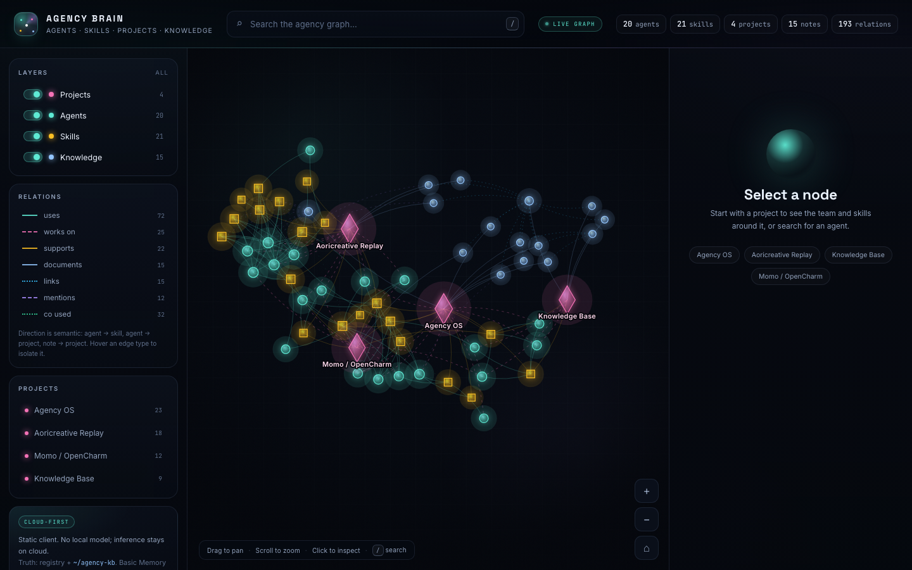

# Agency Brain

A static, Obsidian-style map of how the agency is wired:




- **Agents** load **skills**
- **Agents** work on **projects**
- **Projects** require **skills**
- **Knowledge notes** document projects and link to each other
- Notes can **mention** agents/skills, and skills can be **co-used**

## View

```sh
cd ~/ultimate-agency
./scripts/agency brain --serve
# open http://127.0.0.1:4173/
```

Or open `apps/agency-brain/index.html` directly. The graph is loaded from
`graph.js`, so no local server is required for the basic view.

Regenerate after changing the registry, project map, or vault:

```sh
./scripts/agency brain
```

## Where the semantics come from

| Layer | Source |
|---|---|
| Nodes and agent→skill edges | `agency/registry/agents.json`, `skills.json` |
| Project assignments | `agency/brain/projects.json` |
| Note relationships | YAML frontmatter + Obsidian `[[wikilinks]]` |
| Note→agent/skill mentions | text scan of vault notes |
| Skill clusters | shared-agent co-use |
| Derived search index | Basic Memory (local metadata only; embeddings disabled) |

The generated `graph.json` is the machine-readable projection. It is not a new
source of truth: the registry and `~/agency-kb/` are authoritative. Basic Memory
is rebuildable.

## Interactions

- Drag to pan, scroll to zoom. Labels appear as you zoom in.
- Click a node to inspect its description, metadata, and typed connections.
- Click a project in the sidebar to focus its neighborhood.
- Hover a relation type in the legend to isolate it; click to pin it.
- Press `/` to search. `Esc` clears selection.

## Cloud-first

This is a static client. It does **not** run a local LLM, embedding model, or
GPU workload. Inference remains on the cloud runtime; Basic Memory's local
vector embeddings are disabled. The only local memory is a small SQLite
metadata index (~2 MB), rebuildable from Markdown.

Do **not** publish this folder without access control: it names private
projects and may include paths. Deploy to a private/access-controlled static
host (Cloudflare Pages + Access, Netlify password protection, or an authenticated
private preview). No production deployment is performed by the CLI.
